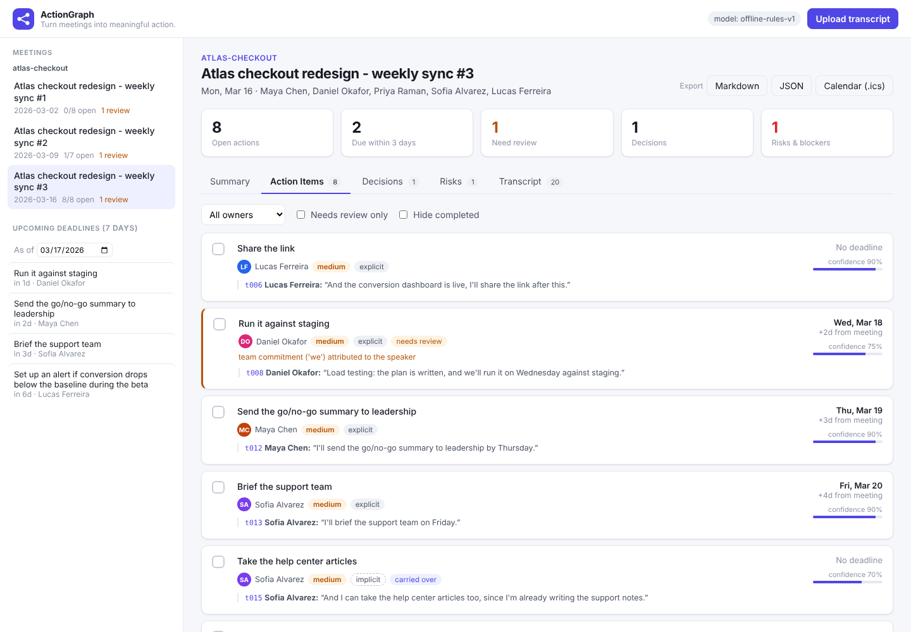
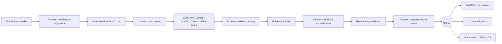

# ActionGraph

**Turn meetings into meaningful action.** ActionGraph converts messy meeting transcripts into
structured decisions, action items, owners, deadlines and risks. Every item links back to the
transcript turn that supports it, and open items are tracked across a meeting series.

[](https://www.python.org/)
[](LICENSE)
[](https://github.com/Navyagowda2714/actiongraph/actions/workflows/ci.yml)
[](https://github.com/astral-sh/ruff)



## Why this exists

Most follow-up work agreed in meetings is never written down as a task. It sits in phrases like
"I'll take a look", "let me dig into that" or "leave it with me", and nobody tracks whether it
happened. Generic meeting summaries make this worse: they read well but cannot be checked. You
can't see who committed to what, and an invented deadline looks exactly like a real one.
ActionGraph treats extraction as an **evidence problem**. Every item cites the speaker turn and
the exact quote it came from, uncertain items are routed to human review, and items carry over
from meeting to meeting until someone reports them done.

## Key features

- **Ingest anything:** TXT, WebVTT, SRT, JSON speaker turns and PDF (via `pypdf`), plus an optional
  audio/video path (faster-whisper or OpenAI Whisper) with diarisation alignment and speaker maps
  (`SPEAKER_00 -> "Hannah Weiss"`).
- **Explicit and implicit commitments:** "I'll send it by Friday" as well as "I'll take a look",
  "let me check", "I can pull that number", each labelled `explicit` or `implicit`.
- **Owner resolution:** "I"/"me" resolve to the speaker; "Priya, could you...?" plus "Yes, I'll set
  that up" resolves to Priya, citing both turns; "we'll..." is attributed to the speaker and
  flagged; "we should..." stays unassigned.
- **Deadline normalisation:** "by end of next week" becomes `2026-03-13`, relative to the meeting
  date and computed deterministically. Ambiguous phrases ("next Thursday" said on a Tuesday) are
  flagged.
- **Evidence-linked and verified:** every item cites `turn_id` + quote; the quote is checked
  against the turn, and items without verifiable evidence are dropped.
- **Confidence and review queue:** low confidence, missing owner, team ownership or unresolved
  deadlines put an item in the review queue, with the reasons attached.
- **Long meetings:** token-bounded chunking with overlapping context turns and cross-chunk de-dup
  (a test checks that chunked and single-pass output are identical).
- **Cross-meeting tracking (SQLite):** open items carry over; completions are detected ("the
  promo code reset bug is fixed" closes "Take a look at the promo code reset bug"); re-raised
  items are linked and can gain an owner. Upcoming and overdue deadlines appear as notifications.
- **Dashboard:** FastAPI + Jinja2 + vanilla JS with Summary / Action Items / Decisions / Risks /
  Transcript tabs, priority chips, owners, due dates, mark-complete, and click-through from
  evidence to the transcript turn.
- **Exports:** Markdown report, JSON, and **ICS calendar** (all-day events with a reminder the
  day before).
- **Pluggable LLMs:** Anthropic, OpenAI, Ollama, or a deterministic offline rule engine behind
  the same interface.

## Architecture



1. **Ingest:** a format-specific parser produces speaker segments. Consecutive segments from the
   same speaker are merged into turns with stable ids, which everything downstream cites.
2. **Extract:** each chunk is sent to the `LLMClient` with a JSON schema. The model returns
   items with *deadline phrases* and *quotes*, never computed dates.
3. **Verify and normalise (deterministic):** quotes are checked against the cited turn, owners
   resolved against participants, deadlines converted to ISO dates relative to the meeting,
   review flags and priority assigned, and chunk overlaps de-duplicated.
4. **Track:** clauses from the new meeting are matched to open items from earlier meetings in the
   same series. Completion cues close items; strong matches are recorded as mentions.

The deep-dive is in [docs/ARCHITECTURE.md](docs/ARCHITECTURE.md): sequence diagram, data model,
ADRs, failure modes, security and scaling.

## Quickstart

```bash
git clone https://github.com/Navyagowda2714/actiongraph && cd actiongraph
python -m venv .venv && source .venv/bin/activate
pip install -e ".[dev]"

make demo     # ingest the 3-meeting sample series into demo.db (offline, no API key)
make serve    # dashboard on http://127.0.0.1:8000/?asof=2026-03-17
make test     # 46 tests
make eval     # precision/recall against the gold annotations
```

**Use a real LLM:** install the extra and set a key. `LLM_PROVIDER=auto` (the default) picks
Anthropic, then OpenAI, and falls back to the offline engine with a warning when no key is set.

```bash
pip install -e ".[anthropic]"
export ANTHROPIC_API_KEY=...            # LLM_MODEL defaults to claude-sonnet-5-5
actiongraph analyze meeting.vtt --series weekly-sync --db actiongraph.db

LLM_PROVIDER=ollama LLM_MODEL=llama3.1 actiongraph analyze meeting.txt   # fully local
```

**Docker:**

```bash
docker build -t actiongraph .
docker run -p 8000:8000 -v actiongraph-data:/data -e ANTHROPIC_API_KEY actiongraph
```

> **Offline mode is a deterministic stand-in.** Without a key, `OfflineProvider` runs a
> transparent rule engine (`extract/rules.py`) behind the LLM interface, so the whole pipeline
> can be tested and demoed. It is a heuristic baseline developed on the sample meetings; real
> extraction quality needs a real model.

## Usage

### CLI

```bash
actiongraph analyze data/samples/heldout_launch_planning_2026-05-12.txt
```

Real output (offline engine, held-out meeting):

```text
Action items (7)
  - [high  ] Get it over to everyone first thing
      owner=Rahul Mehta  due=2026-05-13  explicit  conf=0.90  evidence=t002
  - [medium] Own the one-pager
      owner=Sam Carter  due=2026-05-21  explicit  conf=0.92  evidence=t007,t008
  - [medium] Take a first pass at the FAQ
      owner=Rahul Mehta  due=-  implicit  conf=0.70  evidence=t011
  - [high  ] Ping Marco about it
      owner=Elena Petrova  due=2026-05-12  explicit  conf=0.90  evidence=t015
  - [medium] Book a review session with the exec team
      owner=Nora Kim  due=2026-05-21  explicit  conf=0.90  evidence=t016  [REVIEW: 'next thursday' could mean 2026-05-14]
  ...
```

Cross-meeting tracking from `make demo` (second meeting of the series closing items from the
first):

```text
Cross-meeting tracking
  [done]    Have the full mockups ready (Priya Raman) <- t002: "The mockups went out Wednesday as planned"
  [done]    Take a look at the promo code reset bug (Daniel Okafor) <- t003: "The promo code reset bug is fixed"
  [done]    Dig into the country breakdown and share it in the channel (Lucas Ferreira) <- t004: "I shared the country breakdown in the channel on Tuesday"
  [done]    Escalate it with their account manager (Maya Chen) <- t005: "And I escalated the address vendor issue with their account manager"
  [done]    Get staging refreshed (Daniel Okafor) <- t006: "Staging was refreshed Wednesday afternoon"
  [mention] Write up a short note on what an Adyen migration would actually involve <- t006: "and I've started on the Adyen note"
  [open]    Set that up (A dashboard tracking conversion by step) (Lucas Ferreira)
```

Deadline notifications:

```bash
$ actiongraph notify --db demo.db --today 2026-03-19 --days 5
  OVERDUE by 1d    2026-03-18  Daniel Okafor    Run it against staging
  due TODAY        2026-03-19  Maya Chen        Send the go/no-go summary to leadership
  due in 1d        2026-03-20  Sofia Alvarez    Brief the support team
  due in 4d        2026-03-23  Lucas Ferreira   Set up an alert if conversion drops below the baseline during the beta
```

Other commands: `ingest-series DIR --series NAME`, `export MEETING_ID --format md|json|ics`,
`eval`, `serve`.

### Python

```python
from actiongraph.extract.pipeline import ExtractionPipeline
from actiongraph.ingest import load_transcript
from actiongraph.llm import get_llm

analysis = ExtractionPipeline(get_llm()).run(load_transcript("meeting.vtt"))
for item in analysis.action_items:
    print(item.owner, item.deadline, item.description, [e.turn_id for e in item.evidence])
```

### HTTP API

| Method | Path | Purpose |
|---|---|---|
| `POST` | `/api/meetings` | multipart upload (`file`, optional `title`, `meeting_date`, `series`, `speaker_map`) |
| `GET` | `/api/meetings`, `/api/meetings/{id}` | list meetings / transcript + live analysis + tracking report |
| `PATCH` | `/api/items/{id}` | `{"status": "completed"}`; ids of re-raised items resolve to the original |
| `GET` | `/api/meetings/{id}/export/{md,json,ics}` | downloads |
| `GET` | `/api/notifications?today=&days=` | open items due soon or overdue |
| `GET` | `/api/items/{id}/history` | completion / mention trail with quotes |

See [`examples/`](examples/) for an API client, a series-tracking script and the Python API.

## Evaluation

Gold annotations for 6 self-written meetings: a 3-meeting dev series, plus 3 held-out meetings
in other domains and formats. Numbers below are from `make eval` in this repo, using the
**offline rule engine** (no LLM was reachable here). Dev is the set the rules were built
on, so read the **held-out** column.

| Metric | Dev (23 gold items) | Held-out (20 gold items) |
|---|---:|---:|
| Action items - precision / recall / F1 | 100 / 100 / 100% | 87.0 / 100 / 93.0% |
| Explicit items F1 / implicit items F1 | 100 / 100% | 93.8 / 90.9% |
| Owner accuracy (matched items) | 100% | 100% |
| Deadline accuracy (matched items) | 100% | 95.0% |
| Evidence-link validity (final) | 100% | 100% |
| Decisions F1 | 100% | 28.6% |
| Risks/blockers F1 | 100% | 50.0% |
| False positives flagged for review | - | 2 of 3 |

Cross-meeting completion detection on the dev series: 14/14 completions found with 0 false
closures. The thresholds were tuned on this series, so this is not a generalisation result.
Methodology, error analysis and caveats (small self-written data, rules developed on dev) are in
[docs/EVALUATION.md](docs/EVALUATION.md).

## Design decisions and trade-offs

- **The LLM extracts, code computes.** Models return deadline *phrases* and *quotes*. Dates,
  owner resolution and evidence checks are deterministic, which makes them reproducible and
  testable, and an LLM cannot invent a date.
- **Drop rather than guess.** An item whose quote cannot be found in the cited turn is removed.
  Recall drops a little, but every remaining item can be traced to the transcript.
- **Review queue instead of silent thresholds.** Ambiguity becomes a visible flag with reasons
  ("team commitment ('we') attributed to the speaker", "'next thursday' could mean 2026-05-14").
- **Lexical tracking.** Hashed bag-of-words similarity with owner and verb bonuses: fast,
  download-free and explainable. It will miss heavy paraphrase; the `Embedder` protocol allows a
  semantic model to replace it.
- **Offline engine behind the LLM interface.** It keeps tests and demos honest (same code path),
  and its numbers give a baseline that LLM runs can be compared against.
- **SQLite + single process.** Zero-ops for a team; `Store` is the only thing to swap for
  Postgres.

## Project structure

```text
actiongraph/
├── src/actiongraph/
│   ├── models.py            # pydantic domain + LLM-facing schemas
│   ├── config.py            # pydantic-settings
│   ├── llm/                 # LLMClient protocol, Anthropic/OpenAI/Ollama, Offline, Scripted
│   ├── ingest/              # parsers (txt/vtt/srt/json/pdf), whisper adapter, diarisation alignment
│   ├── extract/             # chunking, prompts, rule engine, deadlines, pipeline
│   ├── tracking/            # SQLite store, cross-meeting tracker
│   ├── export/              # Markdown, JSON, ICS
│   ├── evaluation/          # gold-annotation scoring
│   ├── web/                 # FastAPI app, Jinja2 template, JS/CSS dashboard
│   ├── service.py           # facade used by CLI + API
│   └── cli.py               # typer CLI
├── data/samples/            # 6 authored transcripts (VTT, JSON, TXT, SRT + speaker map)
├── data/gold/               # gold annotations
├── evals/results/           # committed eval output
├── examples/                # runnable scripts
├── tests/                   # 46 pytest tests (no network)
└── docs/                    # ARCHITECTURE.md, EVALUATION.md, screenshots
```

## Roadmap

- Run the evaluation with Claude and GPT models and publish the comparison against the rule
  baseline (the harness is ready).
- Grow the held-out set with transcripts written by other people, plus a held-out *series* for
  tracking.
- Optional semantic embedder (sentence-transformers) for completion matching, compared with the
  lexical baseline.
- Async parallel chunk processing; background job queue for audio transcription.
- Two-way sync with Jira/Linear and Slack reminders for due items.
- Authentication and per-team workspaces.

## License

MIT, see [LICENSE](LICENSE).

Built by [Navyashree Byregowda](https://www.linkedin.com/in/navyashree-byregowda-472821196/)
