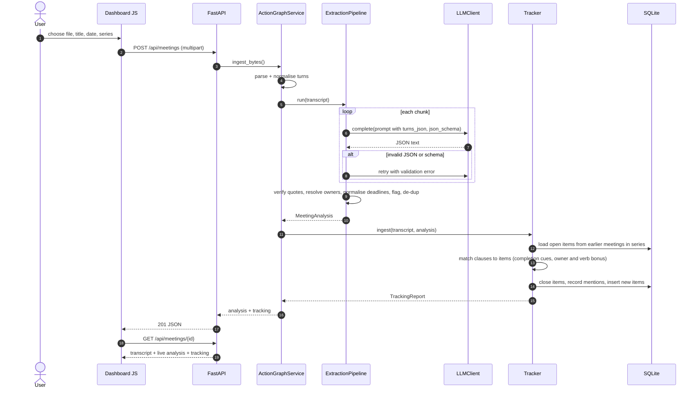
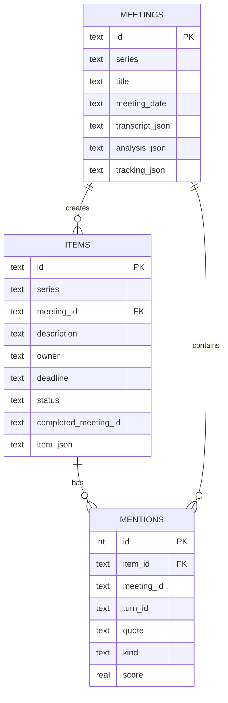
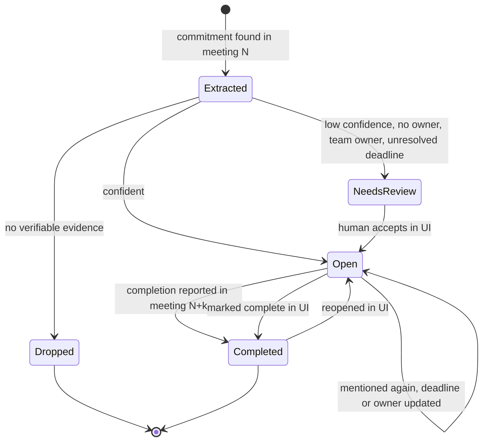

# ActionGraph architecture

## Overview

ActionGraph turns meeting transcripts into structured, evidence-linked records: action items
(owner, deadline, priority, explicit vs implicit), decisions and risks/blockers. It then tracks
those items across a series of meetings, closing them when someone reports them done and
re-linking them when they are raised again.

The design principle is a **narrow LLM surface**. The model (or the offline rule engine that
stands in for it) only does what needs language understanding: find commitments, decisions and
risks, and cite the turns that support them. Everything that needs to be exact is deterministic
code: evidence verification, owner resolution, calendar arithmetic, de-duplication, tracking and
storage.

## Components

```mermaid
flowchart LR
    subgraph Ingest["Ingest"]
        F["TXT / VTT / SRT / JSON / PDF"] --> P["Parsers"]
        A["Audio / video"] --> W["Whisper adapter (optional)"]
        D["Diarisation track"] --> AL["Speaker alignment"]
        W --> AL
        P --> N["Turn normaliser: speaker map, merge, turn ids"]
        AL --> N
    end
    subgraph Extract["Extraction pipeline"]
        N --> C["Chunker with overlap"]
        C --> L["LLMClient: Anthropic, OpenAI, Ollama, Offline rules"]
        L --> V["JSON + schema validation, 1 retry"]
        V --> E["Evidence verifier"]
        E --> O["Owner resolver"]
        O --> DL["Deadline normaliser"]
        DL --> R["Review flags + priority"]
        R --> M["Cross-chunk de-dup"]
    end
    subgraph Track["Tracking"]
        M --> T["Tracker: completions, mentions, re-raises"]
        T --> S[("SQLite store")]
    end
    subgraph Serve["Interfaces"]
        S --> API["FastAPI JSON API"]
        API --> UI["Dashboard: Jinja2 + vanilla JS"]
        S --> CLI["Typer CLI"]
        S --> X["Exports: Markdown, JSON, ICS"]
    end
```

| Component | Module | Responsibility |
|---|---|---|
| Parsers | `ingest/parsers.py` | Format-specific parsing into `Segment`s; metadata from `NOTE` / `#` headers or the filename |
| Audio adapter | `ingest/audio.py` | Lazy `faster-whisper` / OpenAI Whisper back-ends; `assign_speakers` aligns ASR segments with a diarisation track by maximum overlap |
| Turn normaliser | `segments_to_turns` | Applies the speaker map (`SPEAKER_00` -> name), merges consecutive same-speaker segments, assigns stable ids `t001...` |
| Chunker | `extract/chunking.py` | Token-bounded chunks on turn boundaries with `overlap_turns` context turns |
| LLM layer | `llm/` | `LLMClient` protocol, hosted providers (lazy SDK imports), `OfflineProvider`, `ScriptedLLM` for tests, env-driven factory with offline fallback |
| Rule engine | `extract/rules.py` | Deterministic baseline used by `OfflineProvider`; speaks the same JSON contract as a model |
| Pipeline | `extract/pipeline.py` | Prompting, validation/retry, evidence verification, owner and deadline normalisation, review flags, de-dup, summary |
| Deadlines | `extract/deadlines.py` | Phrase detection and conversion to ISO dates relative to the meeting date |
| Similarity | `similarity.py` | `Embedder` protocol; default hashed bag-of-stems + bigrams (numpy, no downloads) |
| Tracker | `tracking/tracker.py` | Closes / mentions / re-links open items from earlier meetings in the same series |
| Store | `tracking/store.py` | SQLite tables for meetings, items and mentions; deadline queries for notifications |
| Service | `service.py` | Facade used by both CLI and API |
| Web | `web/` | FastAPI app, dashboard template, static JS/CSS |
| Evaluation | `evaluation/` | Gold-annotation scoring (P/R/F1, owner/deadline accuracy, evidence validity, tracking) |

## Request lifecycle

The main path is "upload a transcript in the dashboard".

## Data model

Pydantic models (`models.py`) are the contract between layers. `ActionItem` carries
`evidence: list[Evidence]` with `min_length=1`, so an item without evidence cannot be constructed.
The LLM-facing schema (`RawExtraction`) is intentionally looser: deadlines are phrases, owners may
be `"speaker"` or `"we"`. The pipeline converts it to the strict domain model.

Item lifecycle:

## Design decisions

### ADR-1: The LLM extracts phrases, code computes dates

- **Context.** "By Friday" must map to the same date every run, relative to the meeting date
  rather than to the day the pipeline runs. Models are unreliable at weekday arithmetic.
- **Decision.** The model returns `deadline_text` verbatim. `normalise_deadline` converts it with
  explicit conventions (weekday = next occurrence after the meeting; "next <weekday>" later in the
  same week is resolved to the following week and flagged ambiguous), with `dateparser` as the
  fallback for absolute dates.
- **Consequences.** Dates are reproducible and testable (13 parametrised cases). Ambiguous or
  unresolvable phrases ("after the next sync") become review flags rather than invented dates.

### ADR-2: Evidence is verified, unsupported items are dropped

- **Context.** An extracted item nobody can trace back to the transcript is worse than a missing
  one, because users stop trusting the list.
- **Decision.** Every item must cite `turn_id` + quote. The quote must appear in that turn after
  case/punctuation normalisation (or match at 85% or more of characters for minor model edits).
  Invalid citations are removed; items left with no valid citation are dropped and counted in
  `usage.dropped_unsupported`.
- **Consequences.** Final evidence-link validity is 100% by construction. The raw validity rate
  is reported separately, so hallucinated citations from a real model stay visible.

### ADR-3: The offline mode is a rule engine behind the LLM interface

- **Context.** Tests and demos must run without API keys or model downloads, and still exercise
  the real pipeline.
- **Decision.** `OfflineProvider` implements `LLMClient`, reads the turns embedded in the prompt,
  runs `RuleBasedExtractor` and returns schema-valid JSON.
- **Consequences.** Prompt building, JSON parsing, validation, normalisation, de-dup and tracking
  run the same code in offline and hosted modes. The rule engine is a real baseline with
  measurable held-out numbers, but it was developed against the dev meetings, so its dev scores
  are optimistic (see EVALUATION.md).

### ADR-4: Implicit commitments are first-class

- **Context.** A lot of follow-up work is agreed implicitly ("I'll take a look", "let me dig
  into", "I can pull that number", "leave it with me"). These are the items most often forgotten.
- **Decision.** `kind` is either `explicit` or `implicit`, and implicit items get lower
  confidence. Evaluation reports both classes separately.
- **Consequences.** Users can filter or triage soft commitments without losing them.

### ADR-5: Lexical similarity for tracking

- **Context.** Matching "The promo code reset bug is fixed" to "Take a look at the promo code reset
  bug" needs fuzzy matching, but a sentence-transformer means a model download and memory.
- **Decision.** Hashed bag-of-stems + bigram vectors, plus small bonuses when the speaker is the
  owner (or names the owner) and when the clause contains the task's main verb ("triaged" ~
  "Triage"). Completion also requires a past-tense / completion cue with no future or negation
  marker.
- **Consequences.** Fast and dependency-light. Paraphrase-heavy updates will be missed; the
  `Embedder` protocol lets a semantic embedder replace it without other code changes.

### ADR-6: SQLite and a single-process service

- **Context.** The target user is a team or an individual. Deployment friction matters more than
  horizontal scale.
- **Decision.** SQLite with JSON columns for the full transcript and analysis, and relational
  columns for what we query (series, status, deadline).
- **Consequences.** Zero-ops. Moving to Postgres would mean changing only `Store`.

## Failure modes and mitigations

| Failure | Mitigation |
|---|---|
| Model returns malformed JSON or schema violations | Fenced/prose-tolerant JSON parsing, pydantic validation, one retry with the error message; a chunk that still fails is skipped and logged |
| Hallucinated item or quote | Evidence verifier drops it; `dropped_unsupported` and raw validity are surfaced in the UI and eval |
| Request and acceptance split across chunks | `overlap_turns` context turns; cross-chunk de-dup by owner + similarity / shared turns. A test asserts that chunked and single-pass runs produce identical items on a sample meeting |
| "We'll handle it" ownership | Attributed to the speaker, `owner_resolution = team_we`, flagged for review |
| Unresolvable or ambiguous deadline | `deadline = null` or the chosen interpretation, plus a review reason quoting the phrase |
| Recaps double-counting items | Recap turns are skipped for action extraction |
| Wrong completion match | Requires a completion cue, no future/negation marker, and a similarity threshold. Every closure stores its quote and score in `mentions`, and the UI can reopen an item |
| Unknown speakers from ASR | Diarisation alignment + speaker map; unknown labels stay as-is and owners that are not participants are flagged |
| Large uploads | 10 MB limit on upload; long meetings are chunked |

## Security considerations

- **Prompt injection via transcripts.** Transcript text is untrusted. It is passed as JSON data
  inside a delimited block, the output is schema-validated, and every claim must cite verifiable
  text. Injected instructions cannot cause tool execution (there are no tools) and cannot create
  items without matching quotes.
- **XSS.** The dashboard escapes all transcript-derived strings before inserting HTML.
- **Secrets** are read from the environment only (`.env.example` has none); nothing is logged
  beyond counts and ids.
- **Data residency.** Offline and Ollama modes keep transcripts on the machine. Hosted providers
  receive transcript text, which should be a conscious deployment choice.
- **No auth** is built in. Deploy behind an authenticating reverse proxy for multi-user use.

## Scaling and cost

- Cost scales with transcript length: roughly one call per ~1,500-token chunk plus an optional
  summary merge call. A 60-minute meeting (~9k words, ~12k tokens) is about 8 chunks. With a
  small model such as `claude-haiku-5-5` or `gpt-4o-mini` that is a few cents per meeting.
- Chunks are independent, so they can be parallelised with an async client; the current
  implementation is sequential for simplicity.
- Tracking is O(clauses x open items) per meeting with vectorised cosine. That is fine for
  thousands of open items per series; beyond that, add an ANN index per series.
- SQLite handles a single team comfortably. For multi-tenant use, move `Store` to Postgres and
  run ingestion as a background job queue.

## Extending the system

- **New transcript format:** add a `parse_<fmt>` returning `ParsedDocument` and register it in
  `PARSERS`.
- **New LLM provider:** implement `complete(messages, *, system, json_schema, temperature)` and
  add it to `get_llm`.
- **Semantic matching:** implement `Embedder.embed(texts) -> np.ndarray` (for example with
  sentence-transformers) and pass it to `Tracker`.
- **Integrations:** `export.to_ics` covers calendars. Jira/Linear sync would hang off
  `Store.add_items` and `set_status`.
